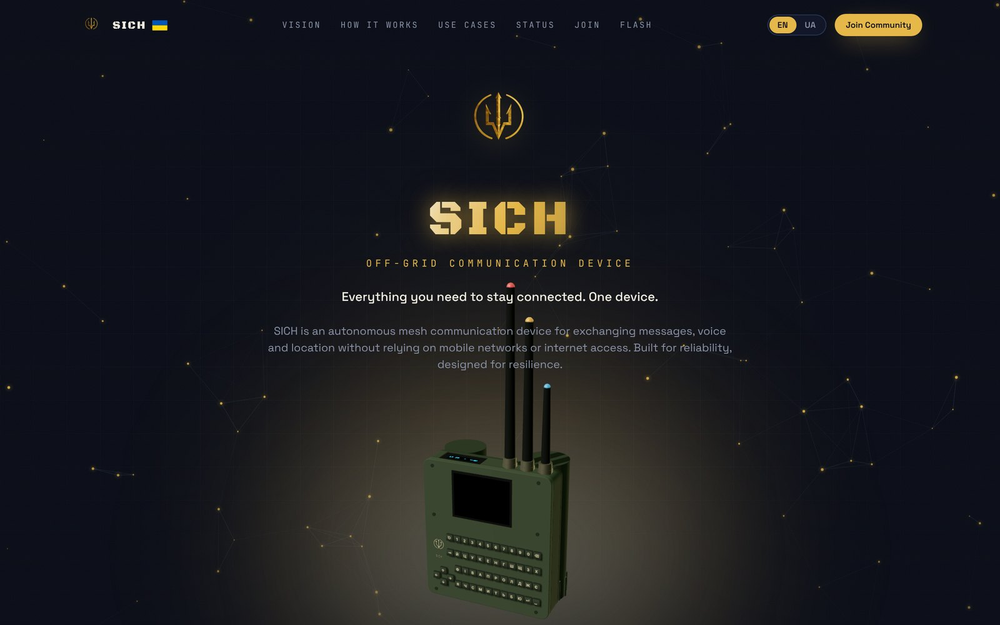

<div align="center">


# SICH

**Off-grid mesh communication — developed by Ukrainians.**

Official website of the SICH project.

[](LICENSE)
[](https://nextjs.org)
[](https://sichmesh.org)
[](https://discord.gg/zpVgjRxdQJ)
[](https://www.youtube.com/@BrainFromUkraine)


[**Website**](https://sichmesh.org) · [**Flash firmware**](https://flasher.sichmesh.org) · [**Discord**](https://discord.gg/zpVgjRxdQJ) · [**YouTube**](https://www.youtube.com/@BrainFromUkraine)

**English** · [Українська](README.uk.md)

<br />



</div>

<br />

## About SICH

SICH is an autonomous communication device. It lets people exchange messages, voice and location over a long-range LoRa mesh — no mobile network, no internet, no infrastructure.

Every device relays traffic for the others, so the network grows with each node and keeps working when cell towers and internet links go down. The project grew out of what happened in Ukraine: when infrastructure fails, people still need to reach each other.

SICH is aimed at civilians, volunteers, technical communities and anyone who needs communication they can rely on in difficult conditions.

> [!NOTE]
> SICH is in active development. Hardware and firmware are at the prototype stage — follow progress on [Discord](https://discord.gg/zpVgjRxdQJ) and [YouTube](https://www.youtube.com/@BrainFromUkraine).

## What's in this repository

| Route | Description |
|---|---|
| `/` | Project landing page — story, vision, how the mesh works, use cases, status. Interactive 3D model of the device. English and Ukrainian. |
| `/flash` | Redirects to the [web flasher](https://flasher.sichmesh.org). |

The page is statically prerendered. Language switching happens instantly on the client.

## Web flasher

Firmware is installed from the browser with the **SICH Web Flasher** — a separate app at [flasher.sichmesh.org](https://flasher.sichmesh.org), developed in [sichmesh/web-flasher](https://github.com/sichmesh/web-flasher). Board makers add their devices there.

`sichmesh.org/flash` redirects to the flasher, so older links keep working.

## Getting started

**Requirements:** Node.js 20 or newer.

```bash
git clone https://github.com/sichmesh/sichmesh.git
cd sichmesh
npm install
npm run dev        # http://localhost:3000
```

```bash
npm run build      # production build
npm start          # serve the production build
```

The build uses `output: "standalone"`, so it runs on any Node.js host.

## Project structure

```
src/
├─ app/
│  ├─ layout.tsx            fonts, metadata, language provider
│  ├─ page.tsx              landing page
│  └─ globals.css           theme and utilities
├─ components/
│  ├─ Header.tsx            navigation and language switch
│  ├─ sections/             landing page sections
│  └─ ui/                   3D device, mesh canvas, shared UI
├─ i18n/
│  ├─ translations.ts       all text, English + Ukrainian
│  └─ LanguageProvider.tsx
├─ lib/deviceScene.ts       three.js scene for the device model
└─ middleware.ts            security headers
public/
└─ fonts/                   self-hosted fonts
```

All text lives in `src/i18n/translations.ts`. To change copy or add a language, edit that file.

## The SICH ecosystem

SICH follows an open model: one project, separate repositories for each part.

| Repository | Description | Status |
|---|---|---|
| **sichmesh** | Website (this repository) | Active |
| **firmware** | Device firmware, with support for third-party boards | Coming soon |
| **protobufs** | Shared packet format for every SICH device | Coming soon |
| **hardware** | PCB, enclosure and bill of materials | Coming soon |
| [**web-flasher**](https://github.com/sichmesh/web-flasher) | Browser flasher for all supported devices | Active |
| **SICH-Android** | Android companion app | Planned |

## Contributing

Issues and pull requests are welcome. For larger changes, open an issue or come to [Discord](https://discord.gg/zpVgjRxdQJ) first so we can discuss the approach.

## License

The source code in this repository is licensed under the [GNU General Public License v3.0](LICENSE).

The **SICH** name, the trident logo and the device renders are not covered by this license. See [TRADEMARK.md](TRADEMARK.md).

<div align="center">
<br />
<sub>Developed by Ukrainians 🇺🇦 · <a href="https://www.youtube.com/@BrainFromUkraine">Brain From Ukraine</a></sub>
</div>
