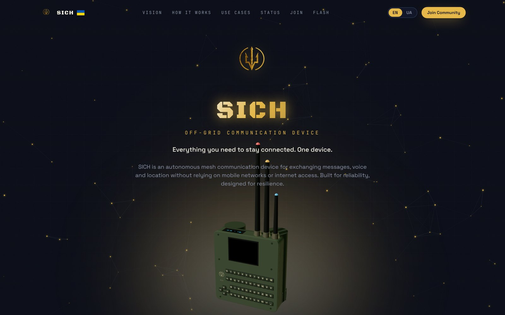

<div align="center">


# SICH

**Автономний mesh-зв'язок — зроблено в Україні.**

Офіційний сайт проєкту SICH.

[](LICENSE)
[](https://nextjs.org)
[](https://sich.network)
[](https://discord.gg/zpVgjRxdQJ)
[](https://www.youtube.com/@BrainFromUkraine)


[**Сайт**](https://sich.network) · [**Прошити пристрій**](https://flasher.sich.network) · [**Discord**](https://discord.gg/zpVgjRxdQJ) · [**YouTube**](https://www.youtube.com/@BrainFromUkraine)

[English](README.md) · **Українська**

<br />



</div>

<br />

## Про SICH

SICH — автономний пристрій зв'язку. Він дає змогу обмінюватися повідомленнями, голосом і геолокацією через LoRa mesh-мережу великої дальності — без мобільного зв'язку, без інтернету, без інфраструктури.

Кожен пристрій передає трафік для інших, тому мережа зростає з кожним новим вузлом і працює далі, коли вежі зв'язку та інтернет недоступні. Проєкт народився з простого спостереження, зробленого в Україні: коли інфраструктура падає, людям усе одно потрібно зв'язатися одне з одним.

SICH створюється для цивільних, волонтерів, технічних спільнот і всіх, кому потрібен надійний зв'язок у складних умовах.

> [!NOTE]
> SICH в активній розробці. Залізо і прошивка на етапі прототипу — стежте за прогресом у [Discord](https://discord.gg/zpVgjRxdQJ) та на [YouTube](https://www.youtube.com/@BrainFromUkraine).

## Що в цьому репозиторії

| Сторінка | Опис |
|---|---|
| `/` | Головна сторінка проєкту — історія, бачення, як працює mesh, сценарії використання, статус. Інтерактивна 3D-модель пристрою. Англійською та українською. |
| `/flash` | Перенаправляє на [веб-прошивальник](https://flasher.sich.network). |

Сторінка статично згенерована заздалегідь. Мова перемикається миттєво, без перезавантаження.

## Веб-прошивальник

Прошивка встановлюється з браузера через **SICH Web Flasher** — окремий застосунок на [flasher.sich.network](https://flasher.sich.network), який розробляється в репозиторії [sichmesh/web-flasher](https://github.com/sichmesh/web-flasher). Саме туди виробники додають свої плати.

`sich.network/flash` перенаправляє на прошивальник, тож старі посилання працюють.

## Швидкий старт

**Потрібно:** Node.js 20 або новіший.

```bash
git clone https://github.com/sichmesh/sichmesh.git
cd sichmesh
npm install
npm run dev        # http://localhost:3000
```

```bash
npm run build      # продакшн-збірка
npm start          # запуск продакшн-збірки
```

Збірка використовує `output: "standalone"`, тож запускається на будь-якому Node.js-хостингу.

## Структура проєкту

```
src/
├─ app/
│  ├─ layout.tsx            шрифти, метадані, провайдер мови
│  ├─ page.tsx              головна сторінка
│  └─ globals.css           тема та утиліти
├─ components/
│  ├─ Header.tsx            навігація і перемикач мови
│  ├─ sections/             секції головної сторінки
│  └─ ui/                   3D-пристрій, mesh-анімація, спільний UI
├─ i18n/
│  ├─ translations.ts       усі тексти, англійська + українська
│  └─ LanguageProvider.tsx
├─ lib/deviceScene.ts       three.js сцена моделі пристрою
└─ middleware.ts            заголовки безпеки
public/
└─ fonts/                   власні шрифти
```

Усі тексти лежать у `src/i18n/translations.ts`. Щоб змінити текст або додати мову — редагуйте цей файл.

## Екосистема SICH

SICH побудований за відкритою моделлю: один проєкт, окремий репозиторій для кожної частини.

| Репозиторій | Опис | Статус |
|---|---|---|
| **sichmesh** | Сайт (цей репозиторій) | Активний |
| **firmware** | Прошивка пристроїв з підтримкою плат інших виробників | Скоро |
| **protobufs** | Спільний формат пакетів для всіх пристроїв SICH | Скоро |
| **hardware** | Друкована плата, корпус і перелік компонентів | Скоро |
| [**web-flasher**](https://github.com/sichmesh/web-flasher) | Прошивальник з браузера для всіх підтримуваних пристроїв | Активний |
| **SICH-Android** | Застосунок для Android | Заплановано |

## Як долучитися

Issues і pull requests вітаються. Для великих змін спершу відкрийте issue або напишіть у [Discord](https://discord.gg/zpVgjRxdQJ), щоб обговорити підхід.

## Ліцензія

Вихідний код у цьому репозиторії поширюється за ліцензією [GNU General Public License v3.0](LICENSE).

Назва **SICH**, логотип-тризуб і рендери пристрою не підпадають під цю ліцензію. Деталі — у [TRADEMARK.md](TRADEMARK.md).

<div align="center">
<br />
<sub>Зроблено в Україні 🇺🇦 — <a href="https://www.youtube.com/@BrainFromUkraine">Brain From Ukraine</a></sub>
</div>
